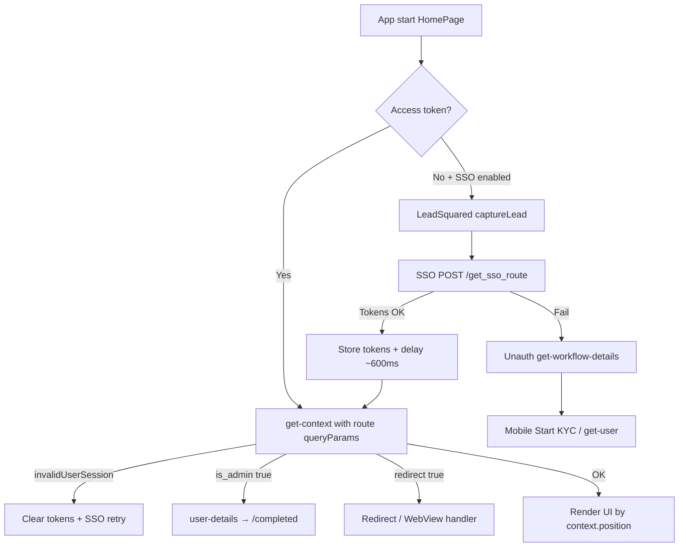

# Meon KYC (BP) — Complete API & Conditional Flow Documentation

> **Single developer reference** for this KYC App.  
> **Source of truth:** `lib/pages/home_page.dart`, `lib/pages/webview_page.dart`, `lib/store/app_store.dart`, `lib/api/*`  
> **Aligned with codebase:** Nov 2026

---

## Table of contents

1. [Quick mental model](#1-quick-mental-model)
2. [Environment, auth & headers](#2-environment-auth--headers)
3. [Architecture & files](#3-architecture--files)
4. [Routes](#4-routes)
5. [End-to-end journey](#5-end-to-end-journey)
6. [Master conditional flowcharts](#6-master-conditional-flowcharts)
7. [Complete API catalog (1–17)](#7-complete-api-catalog-117)
8. [Core engine: get-context ↔ kyc-post-v2](#8-core-engine-get-context--kyc-post-v2)
9. [WebView return → params → get-context → kyc-post-v2](#9-webview-return--params--get-context--kyc-post-v2) ⭐
10. [Step-wise `kyc-post-v2` body rules](#10-step-wise-kyc-post-v2-body-rules)
11. [Step-specific product / UI rules](#11-step-specific-product--ui-rules)
12. [Field-level conditional flow & validation](#12-field-level-conditional-flow--validation)
13. [File upload & PDF password](#13-file-upload--pdf-password)
14. [WebView extras (UPI, Digio, timeouts)](#14-webview-extras-upi-digio-timeouts)
15. [Error & session recovery](#15-error--session-recovery)
16. [Developer checklist](#16-developer-checklist)
17. [Appendix](#17-appendix)

---

## 1. Quick mental model

```
READ  = POST /api/get-context/{company}/{workflow}[?query]
WRITE = POST /api/kyc-post-v2/{company}/{workflow}/{page.name}{page.id}
```

| Role | API | What it does |
|------|-----|--------------|
| **Where am I?** | `get-context` | Returns `context.position`, page fields, `redirect`, `is_admin` |
| **Submit / verify** | `kyc-post-v2` | Saves/validates current step; then client always calls get-context again |
| **BP login** | LeadSquared → SSO `/get_sso_route` | Issues tokens; then get-context |
| **Fallback login** | `POST /api/get-user/...` | Mobile OTP start if SSO fails |

**Critical rule about WebView returns:**

> When the user finishes DigiLocker / eSign / IPV / Reverse Penny Drop / Account Aggregator,  
> **completion query params are sent to `get-context` (URL query + sometimes JSON body).**  
> They are **not** dumped into `kyc-post-v2` as WebView return params.  
> `kyc-post-v2` is used later when the user submits the **next in-app form step** (with that step’s form fields).  
> Exception: Reverse Penny Drop **back** sets `rpd_return` which can later appear on **personal_details** `kyc-post-v2`.

```
┌──────────────┐  success   ┌─────────────┐
│ kyc-post-v2  │ ─────────► │ get-context │
└──────────────┘            └──────┬──────┘
                                   │
              ┌────────────────────┼────────────────────┐
              ▼                    ▼                    ▼
        Render step          Open WebView          /completed
     (by position)         (redirect=true)        (is_admin)
              ▲                    │
              │    return with     │
              │    query params    │
              └────────────────────┘
                   (get-context again)
```

**Defaults** (`lib/config/env_config.dart`):

| Key | Value |
|-----|-------|
| Base URL | `https://ekyc.stoxbox.in` |
| Company | `bpwealth` |
| Workflow | `app_test` |

---

## 2. Environment, auth & headers

### 2.1 Authenticated headers

Applied by `BaseAPI` / `ApiClient` when an access token exists:

| Header | Source |
|--------|--------|
| `Content-Type: application/json` | Default for JSON |
| `Authorization: Bearer {access_token}` | `StorageService` |
| `X-CSRF-TOKEN` | JWT claim `csrf` (if present) |
| `Cookie: session_id={session_id}` | JWT claim `session_id` (if present) |

**No Bearer:** LeadSquared, SSO `/get_sso_route`.  
**Refresh call:** `Authorization: Bearer {refresh_token}` → `POST /api/user/refresh`.  
**Multipart:** same Bearer/CSRF/Cookie; often `accept: */*`. Upload/PDF often use `skipRefreshOn401: true`.

### 2.2 Token refresh (`lib/api/interceptor.dart`)

```
HTTP 401 or 422
    → single-flight POST /api/user/refresh
    → success: store new tokens, retry original request
    → fail: StorageService.clearAll() + toast "Session expired…"
```

Request timeout: **600 seconds**.

### 2.3 Storage keys

Secure storage: `access_token`, `refresh_token`, `auth_success`, `message`, `userStep`, `user_data`  
Process-lifetime flag: `ssoAutoLoginEnabled` (default `true`).

**First-install wipe:** SharedPreferences flag `has_run_before`. On first app run after install, secure storage is cleared (`clearAll`) so stale JWT from a previous install cannot resume KYC incorrectly (`StorageService`).

**SSO credentials (temp):** static mobile/email from `lib/sso/sso_temp_credentials_gate.dart` (`kSsoStaticCredentials` / `resolveSsoCredentials()`). Replace when host app passes real credentials. `kHideOnboardingFormFooter` hides onboarding footer on host screens.

---

## 3. Architecture & files

```
UI: HomePage / WebViewPage / FormFieldWidget / KycCompletedPage
              │
              ▼
AppStore (Provider)  ←→  ConditionalFormNotifier
              │
    ┌─────────┼──────────┬────────────────┐
    ▼         ▼          ▼                ▼
 KycAPI    SsoAPI   LeadSquaredAPI   PdfPasswordService
    └─────────┴──────────┴────────────────┘
                    │
              ApiClient → ApiInterceptor → BaseAPI (http)
                    │
              EnvConfig.baseUrl
```

| Concern | Path |
|---------|------|
| Orchestration (submit, OTP, bank, redirects) | `lib/pages/home_page.dart` |
| External verification WebView | `lib/pages/webview_page.dart` |
| get-context / stepper / user-details | `lib/store/app_store.dart` |
| Form values + visibility | `lib/hooks/conditional_form.dart` |
| Operators, nominee rules, body filters | `lib/utils/conditional_flow.dart` |
| Field validation | `lib/utils/field_validators.dart` |
| PAN DOB formats | `lib/utils/kyc_date_utils.dart` |
| Network | `lib/api/*` |
| Tokens | `lib/services/storage_service.dart` |
| Static SSO credentials (temp) | `lib/sso/sso_temp_credentials_gate.dart` |

---

## 4. Routes

| Path | Page | Notes |
|------|------|-------|
| `/` | redirect | → `/{EnvConfig.companyName}/{EnvConfig.workflowName}` |
| `/:company/:workflowName` | `HomePage` | **All query params** from URL → `HomePage.queryParams` |
| `/:company/:workflowName/webview?url=&title=` | `WebViewPage` | Fade `CustomTransitionPage`; DigiLocker / eSign / RPD / IPV / AA |
| `/:company/:workflowName/completed` | `KycCompletedPage` | When `is_admin == true` |
| `/404` | `PageNotFound` | |

Example after DigiLocker return:

```
/bpwealth/app_test?verify=digilocker&success=yes&...
```

`app.dart` maps `state.uri.queryParameters` → `HomePage(queryParams: ...)`.

**Connectivity:** `AppConnectivityGate` wraps the app; probes `EnvConfig.baseUrl` and `https://www.google.com/generate_204`.

---

## 5. End-to-end journey

Typical BP Wealth path (positions come from backend; names can vary by workflow config):

1. **Launch** → LeadSquared lead capture → SSO tokens → get-context  
2. If already done (`is_admin`) → completed page  
3. Mobile / email / OTP (if SSO lands mid-flow or fallback)  
4. Segments → PAN / KRA → DigiLocker (WebView) → DigiLocker review form  
5. Personal details → Nominees → Bank (IFSC + penny drop)  
6. Possible Reverse Penny Drop / Account Aggregator WebViews  
7. Uploads (PAN / signature / income / bank proof) + PDF password checks  
8. Live image / IPV WebView  
9. eSign WebView  
10. Completed (`is_admin`)

Default stepper labels (full fallback list in `KycStepperBar.defaultSteps`):

```
mobile → mobile_otp → email → email_otp → segments → detailspan → kra_fetch_new →
kradetails → digilocker → pan → personal_details → nominee → additional_nominee →
additional_nominee_second → nominee_mobile → mobile_otp → reverse_pennydrop → bank →
bank_details → account_aggregator → liveimage → pan_upload → sign_upload →
income_proof → bank_upload → pdf → esign → complete
```

Live stepper labels usually come from `POST /kycadmin_getWorkflow/...` (API 14), not this static list.

---

## 6. Master conditional flowcharts

### 6.1 App launch / session



### 6.2 Per-step submit

```mermaid
flowchart TD
  S[Submit / Verify / Next] --> V{Client validation}
  V -->|Fail| T[Toast — stay]
  V -->|OK| P[_prepareFormData + step body rules]
  P --> U{Files?}
  U -->|saveFilesAPI true| UF[upload_files_new each]
  U -->|files + saveFilesAPI false| MP[multipart kyc-post-v2]
  U -->|no files| JS[JSON kyc-post-v2]
  UF --> JS
  MP --> R{Response}
  JS --> R
  R -->|success true| GC[_afterKycPostV2Success → get-context]
  R -->|Bank penny special| PD[Proceed / Modify dialog]
  R -->|PAN already exists| REC[user-details match → advance]
  R -->|Error| ERR[Toast / inline — stay]
  PD -->|Proceed| P2["kyc-post save:true middlewareCall:false"]
  PD -->|Modify| P3["kyc-post retake:true"]
  GC -->|is_admin| DONE[/completed]
  GC -->|redirect| WV[WebView or verify reload]
  GC -->|else| NEXT[New step UI]
```

### 6.3 OTP

```
mobile → mobile_otp
  Verify → kyc-post-v2/{mobile_otp}{id}  (otp in body, NO save)
  Fail   → toast, stay
  Resend → POST /api/resend-otp/{mobile_otp}{id}  body {}
  Edit   → GET /api_review_edit_page/.../change_mobile → get-context

email → email_otp
  Same pattern
  Resend body { "email": "<email>" }
  Edit field: change_email
```

---

## 7. Complete API catalog (1–17)

Base: `https://ekyc.stoxbox.in`  
`{company}` / `{workflow}` from route (default `bpwealth` / `app_test`).

---

### API 1 — LeadSquared capture (pre-SSO)

| | |
|--|--|
| **Method / URL** | `POST https://ekyc.stoxbox.in/leadsquared_api/bp` |
| **Auth** | None |
| **Code** | `LeadSquaredAPI.captureLead` ← `HomePage._fetchKycLeadIdBeforeSso` |

**Request:**

```json
{
  "payload": [
    { "Attribute": "SearchBy", "Value": "Phone" },
    { "Attribute": "Phone", "Value": "<mobile>" },
    { "Attribute": "FirstName", "Value": "" },
    { "Attribute": "mx_Lead_Age_Group", "Value": "" },
    { "Attribute": "Source", "Value": "App" },
    { "Attribute": "mx_UTMSource", "Value": "App" },
    { "Attribute": "SourceMedium", "Value": "App" },
    { "Attribute": "SourceCampaign", "Value": "In_app_kyc" },
    { "Attribute": "mx_CommSource", "Value": "In_app_kyc" },
    { "Attribute": "mx_Ad_Group", "Value": "" },
    { "Attribute": "SourceContent", "Value": "App" }
  ],
  "timeout": 120
}
```

**Success:** HTTP 2xx AND (`success == true` OR `data.Status == success` OR `status_code == 200`).  
**Lead ID:** `data.Message.RelatedId` → SSO `additional_info.kyc_lead`.  
**Fail:** `null`; SSO continues without lead id.

---

### API 2 — SSO route tokens

| | |
|--|--|
| **Method / URL** | `POST /get_sso_route` |
| **Auth** | None |
| **Code** | `SsoAPI.getSsoRouteTokens` |

**Request:**

```json
{
  "company": "bpwealth",
  "workflowName": "app_test",
  "generate_access_token": true,
  "skip_reverification": true,
  "secret_key": "<EnvConfig.ssoSecretKey>",
  "notification": false,
  "unique_keys": {
    "mobile_number": "<mobile>",
    "select_dependancy": "Self"
  },
  "additional_info": {
    "email": "<email>",
    "Phone": "<mobile>",
    "firstname": "",
    "age_group": "",
    "source": "App",
    "mx_utmsource": "App",
    "source_medium": "App",
    "source_campaign": "In_app_kyc",
    "mx_comsource": "In_app_kyc",
    "mx_adgroup": "",
    "sourcecontent": "App",
    "kyc_lead": "<optional>"
  },
  "temp_data": { "is_sso": "yes" }
}
```

**Success:** Extract nested `access_token`/`token` + `refresh_token`/`refresh`.  
**Fail:** `null` → unauth workflow / OTP path.  
**Next:** Store tokens → delay → **get-context**.

---

### API 3 — Get workflow details (unauth)

| | |
|--|--|
| **Method / URL** | `POST /api/get-workflow-details/{company}/{workflow}` |
| **Body** | `{}` |
| **When** | No token; logout fallback |

---

### API 4 — Get user (Send OTP / start)

| | |
|--|--|
| **Method / URL** | `POST /api/get-user/{company}/{workflow}` |
| **When** | Unauth mobile submit (`_handleSubmit`) |

**Client gates:** mobile 10 digits starting 6–9; T&C when mobile start.  
**Success:** tokens + then get-context.

---

### API 5 — Get context ⭐

| | |
|--|--|
| **Method / URL** | `POST /api/get-context/{company}/{workflow}[?query]` |
| **Auth** | Bearer |
| **Code** | `AppStore.fetchWorkflowFieldsWithAuth` |

See [§8](#8-core-engine-get-context--kyc-post-v2) and [§9](#9-webview-return--params--get-context--kyc-post-v2).

---

### API 6 — KYC post v2 ⭐

| | |
|--|--|
| **Method / URL** | `POST /api/kyc-post-v2/{company}/{workflow}/{pathSegment}` |
| **pathSegment** | `page.name + page.id` (e.g. `bank18`, `digilocker9`, `mobile_otp2`) |
| **When** | User submits/verifies an in-app step |

See [§8](#8-core-engine-get-context--kyc-post-v2) and [§10](#10-step-wise-kyc-post-v2-body-rules).

---

### API 7 — Upload files

| | |
|--|--|
| **Method / URL** | `POST /api/upload_files_new` |
| **Type** | Multipart; field name = API field name |
| **When** | `page.saveFilesAPI == true` and form has files |
| **Auth** | Bearer; `skipRefreshOn401: true` |

Fail → toast `Failed to upload {field}` → abort submit.

---

### API 8 — Resend OTP

| | |
|--|--|
| **Method / URL** | `POST /api/resend-otp/{position}{page.id}` |

| Call | Body |
|------|------|
| Mobile | `{}` |
| Email | `{ "email": "<email>" }` |

---

### API 9 — Review / edit page

| | |
|--|--|
| **Method / URL** | `GET /api_review_edit_page/{company}/{workflow}/{currentField}` |
| **currentField** | `change_mobile` or `change_email` |

Success → get-context.

---

### API 10 — User details

| | |
|--|--|
| **Method / URL** | `POST /api/user-details` body `{}` |

Used for DigiLocker photo, completed page, PAN-already-exists recovery.

---

### API 11 — Position update (RPD back)

| | |
|--|--|
| **Method / URL** | `POST /api/position-update` |
| **Body** | `{ "position": "11" }` (hardcoded) |
| **When** | User presses Back on Reverse Penny Drop WebView |

Next: get-context with body `{ "rpd_return": true }`.

---

### API 12 — Logout

`POST /api/user/logout` → `clearAll` → **SSO again** → get-context.

> Current BP path does **not** fall back to unauth “Start your KYC” / `get-workflow-details` after logout (that branch is commented out in `HomePage._handleLogout`).

---

### API 13 — Refresh token

`POST /api/user/refresh` with Bearer **refresh** token.

---

### API 14 — Stepper workflow

`POST /kycadmin_getWorkflow/{workflowName}/{workflowId}`  
`workflowId` from `design_template` middle segment (`company-workflowId-n`).  
Hides stepper labels: `cdsl_upload`, `nse`, `bse`, `kra_new`, `backoffice`.

---

### API 15 — IFSC lookup

`POST /get_bank_address_by_ifsc` body `{ "ifsc": "<11 chars>" }`  
Only autofills when position is `bank` / `bank_details`.

**Response → form mapping:**

| API field | Form fields |
|-----------|-------------|
| `bank_name` | bank name field(s) |
| `BRANCH` | branch_* |
| `address` | `bank_address` / `bank_add` |
| `city`, `district`, `state`, `pincode` | matching fields |
| `micr` | `micr` / `micr1` |

Empty `bank_name` or non-200 → toast **Invalid IFSC code**.

---

### API 16 — PDF password check

`POST /pdfPassCheck/{workflowKey}` multipart `financial` = PDF.

---

### API 17 — PDF password verify

`POST /verifyPdfPassword/{encodedPassword}/{workflowKey}` multipart `financial`.

---

## 8. Core engine: get-context ↔ kyc-post-v2

### 8.1 get-context request

```
POST /api/get-context/{company}/{workflow}?{queryString}
Body: { ...optional JSON... }
```

**How query string is built on Home load:**

```dart
// HomePage._loadWorkflow
queryString = widget.queryParams.isEmpty
  ? ''
  : '?' + Uri.encodeComponent each key/value from route
```

So whatever WebView put on the Home URL becomes the get-context query.

**JSON body conditions:**

| Condition | Body |
|-----------|------|
| Query contains `verify=digilocker` | `{ "save": true }` (+ any other postBody) |
| `store.rpdReturn == true` | `{ "rpd_return": true }` |
| Explicit `postBody` arg | Merged into body |
| Normal step refresh after kyc-post | Usually `{}` with **empty** query |

**Important success response fields:**

```json
{
  "success": true,
  "is_admin": false,
  "redirect": false,
  "url": null,
  "msg": "",
  "context": {
    "position": "bank",
    "index": "...",
    "design_template": "bpwealth-2321998632-76",
    "page": {
      "name": "bank",
      "id": "18",
      "saveFilesAPI": false,
      "data": { "label": "bank" },
      "fields": [ /* field definitions */ ]
    }
  }
}
```

**Branching after get-context:**

| Condition | Action |
|-----------|--------|
| `success != true` | Show `error.msg` or `msg` |
| HTTP 500 generic HTML | Retry up to 3 times |
| 401/403 or 404 user not found | `invalidUserSession` → SSO |
| Encrypted PDF message | Stay on upload; clear file/`*_pass` |
| `is_admin == true` | `/completed` + user-details |
| `redirect == true` + `url` | See redirect / WebView rules (§9) |
| Else | Render `context.position` |

### 8.2 kyc-post-v2 request

```
POST /api/kyc-post-v2/{company}/{workflow}/{page.name}{page.id}
```

**Path segment example:** page `name=bank`, `id=18` → `bank18`.

**After every successful kyc-post-v2:**

1. Optionally clear `rpd_return` state if personal_details submitted with it  
2. Save `step` to storage  
3. Call **get-context** again (usually empty query; optional `postBody`)  
4. If `is_admin` → completed  
5. Else apply new fields → `_checkAndHandleRedirect`

**Default body rule:** do **not** send `save` (stripped in `_prepareFormData`). Exceptions in §10.

---

## 9. WebView return → params → get-context → kyc-post-v2

This is the most important section for future development.

### 9.1 Mental model (do not confuse APIs)

```
┌─────────────────┐
│  External site  │  DigiLocker / Digio eSign / IPV / RPD / CAMS AA
└────────┬────────┘
         │ completion URL with query params
         ▼
┌─────────────────┐
│   WebViewPage   │  Captures params into _completionParams
└────────┬────────┘
         │ context.go('/company/workflow?param=value...')
         ▼
┌─────────────────┐
│    HomePage     │  queryParams from route
└────────┬────────┘
         │
         ▼
┌─────────────────────────────────────────────────────────┐
│  POST /api/get-context/...?...params...                 │
│  (+ body save:true if verify=digilocker)                │
│  Backend marks external step complete / advances        │
└─────────────────────────────────────────────────────────┘
         │
         ▼
   New context.position (in-app form)
         │
         │ user fills form & taps Submit
         ▼
┌─────────────────────────────────────────────────────────┐
│  POST /api/kyc-post-v2/.../{page.name}{page.id}         │
│  Body = current step form fields (NOT WebView params)   │
└─────────────────────────────────────────────────────────┘
```

**So:** WebView return params → **get-context query (and sometimes body)**.  
**kyc-post-v2** gets the **next form step’s data**, not the raw WebView URL bag — except special flags like `rpd_return` on personal_details.

---

### 9.2 Which params WebView captures

**File:** `WebViewPage._captureCompletionParamsIfApplicable`  
**Storage:** `_completionParams` map  
**When:** On navigation / load stop when URL is on our domain (`meon.co.in` / `stoxbox.in`, not `api.` / `accounts.`).

**WebView capture-trigger keys** (`completionParamKeys` in `webview_page.dart` — case-insensitive match):

| Key | Typical meaning |
|-----|-----------------|
| `success` | Often `yes` after IPV / RPD / generic success |
| `esign` | Often `yes` after eSign |
| `transaction_id` | Digio / RPD transaction id |
| `verifycompleted` | IPV completed flag |
| `reversepennydrop` | RPD marker (**no underscore** in WebView list) |
| `account_aggregator` | CAMS / AA flow marker |
| `ecres`, `resdate`, `fi` | AA / CAMS response fields |

Also captured: **all other non-empty query params** on that URL, **except** it will not override routing keys `state`, `client_token`, `auto` from intermediate domains (those come from the final workflow URL).

**Home “has completion params” check** (slightly wider than WebView list):

```
success == yes OR verifyCompleted == true OR esign == yes OR
has transaction_id OR reversepennydrop OR reverse_pennydrop OR account_aggregator
```

Note: Home accepts both `reversepennydrop` and `reverse_pennydrop`; WebView trigger list only has `reversepennydrop`.

---

### 9.3 How WebView hands off to Home

**Method:** `_handleRedirectComplete(...)`

#### Case A — IPV success (`verifyCompleted: true`)

Triggered when return URL has `success=yes` (and/or `state`) on our workflow path.

1. Builds:

```
queryParams = {
  "state": "<if present>",
  "success": "yes"
}
```

2. If token exists → **calls get-context immediately from WebView** with that query string.  
3. Then navigates to Home **without** query (API already done):  
   `context.go('/{company}/{workflow}')`  
4. If no token / error → navigates **with** query so Home can call get-context.

#### Case B — DigiLocker / eSign / RPD / AA / other (`verifyCompleted: false`)

1. Builds:

```
queryParams = {
  "state": "<optional>",
  "client_token": "<optional>",
  "auto": "<optional>",
  ..._completionParams   // success, transaction_id, esign, etc.
}
```

2. If DigiLocker flow → **force** `queryParams['verify'] = 'digilocker'`.  
3. Navigate:

```
context.go('/{company}/{workflow}?verify=digilocker&success=yes&transaction_id=...&...')
```

4. Home `_loadWorkflow` → get-context with **that full query string**.

#### Case C — User presses Back on Reverse Penny Drop

1. `KycAPI.positionUpdate('11')` → `{ "position": "11" }`  
2. `store.setRpdReturn(true)`  
3. get-context with body:

```json
{ "rpd_return": true }
```

(empty query)  
4. Navigate to Home without completion params; **do not reopen RPD WebView**.

---

### 9.4 Exact get-context calls per WebView flow

| Flow | Route / trigger | get-context **query** | get-context **body** |
|------|-----------------|------------------------|----------------------|
| DigiLocker complete | Home `?verify=digilocker&…` | `verify=digilocker` (+ any captured params) | `{ "save": true }` because `verify=digilocker` |
| DigiLocker pass 2 | msg `redirect on verify is true` | Query extracted from redirect `url` (often still digilocker verify) | `save: true` if verify=digilocker still present |
| IPV success | WebView calls API or Home `?success=yes&state=` | `success=yes` & `state=…` | `{}` (unless rpdReturn) |
| eSign complete | Home `?esign=yes&…` | `esign=yes` (+ others) | `{}` |
| RPD success URL | Home `?success=yes&transaction_id=…` | those params | `{}` |
| RPD user Back | position-update then Home | _(empty)_ | `{ "rpd_return": true }` |
| Account Aggregator | Home with AA params (`account_aggregator`, `ecres`, …) | those params | `{}` |

**AppStore rule that adds DigiLocker body:**

```dart
if (queryParams['verify'] == 'digilocker') {
  requestBody['save'] = true;
}
```

---

### 9.5 What Home does after get-context with completion params

```dart
hasCompletionParams =
  success == 'yes' OR
  verifyCompleted == 'true' OR
  esign == 'yes' OR
  has transaction_id OR
  has reversepennydrop / reverse_pennydrop OR
  has account_aggregator
```

| Branch | Behaviour |
|--------|-----------|
| `verify=digilocker` | `_handleDigilockerVerifyReturn` (possible second get-context; then clean URL) |
| **No** completion params | Normal `_checkAndHandleRedirect` (may open WebView) |
| **Has** completion params | See detailed order below |

**Completion-params return order:**

1. If get-context response already has external `redirect`+`url` → **open WebView immediately** (`_shouldOpenRedirectImmediately`) — do not wait for a second slow get-context.  
2. Else refresh get-context with **empty query** (fresh in-app state).  
3. If error message contains **`multiple tabs`** → wait 800ms → retry get-context once.  
4. If still failing while `isReturningFromWebView` → show return-flow retry UI (do not flash old step form).  
5. If `is_admin` → completed.  
6. Else `_checkAndHandleRedirect` again; if no redirect → `go` to clean Home URL.

**Skip reopen WebView when:**

- `rpdReturn` and URL is RPD  
- Already processed DigiLocker verify and redirect still digilocker  
- Completion params present (unless immediate next external URL must open)

**Loader:** `store.isReturningFromWebView` drives full-screen return-flow loader + watchdog timers so previous step UI does not flash.

---

### 9.6 When does this reach `kyc-post-v2`?

| After WebView… | Next in-app step | What goes into kyc-post-v2 |
|----------------|------------------|----------------------------|
| DigiLocker | DigiLocker **review** form (`position=digilocker`) | Visible review fields + **`save: true`** |
| IPV | Whatever get-context returns next | That step’s form fields only |
| eSign | Usually near end / complete | That step’s fields; often little left |
| RPD success | Bank / next bank step | Bank form fields (IFSC, account, …) |
| RPD **Back** | Often `personal_details` | Form fields + **`rpd_return: true`** if that field exists and `store.rpdReturn` |
| AA | Next financial / bank related step | That step’s fields |

#### DigiLocker → kyc-post-v2 example

```
1) WebView done
2) GET-CONTEXT
   POST /api/get-context/bpwealth/app_test?verify=digilocker
   Body: { "save": true }

3) User reviews DigiLocker fields on Home, taps Continue
4) KYC-POST-V2
   POST /api/kyc-post-v2/bpwealth/app_test/digilocker9
   Body: {
     "...review fields...": "...",
     "save": true
   }

5) GET-CONTEXT again (empty query) → next position
```

#### RPD Back → personal_details → kyc-post-v2 example

```
1) WebView Back
2) POST /api/position-update  { "position": "11" }
3) GET-CONTEXT  Body: { "rpd_return": true }

4) Home sets form field rpd_return = true (if field exists on personal_details)

5) User submits personal_details
6) KYC-POST-V2
   POST /api/kyc-post-v2/.../personal_details{id}
   Body includes: { "rpd_return": true, ...other visible fields... }

7) After success → clear rpd_return from store + form (do not send on later steps)
```

#### Bank (no WebView return params in kyc-post)

```
1) User fills IFSC / account on bank step
2) KYC-POST-V2 /bank18  { ifsc, account_number, ... }   // usually NO save
3) If penny-drop dialog:
   Proceed → { "save": true, "middlewareCall": false, ifsc, account_number, ... }
   Modify  → { "retake": true, ... }
4) GET-CONTEXT → next step or stay on bank for upload path
```

---

### 9.7 Example Postman-style sequences

#### Sequence A — DigiLocker return

```http
### 1) After WebView — mark DigiLocker complete
POST {{base}}/api/get-context/{{company}}/{{workflow}}?verify=digilocker
Authorization: Bearer {{access_token}}
Content-Type: application/json

{ "save": true }

### 2) User confirms DigiLocker review form
### pathSegment = context.page.name + context.page.id (dynamic — not hardcoded)
POST {{base}}/api/kyc-post-v2/{{company}}/{{workflow}}/{{digilockerPageName}}{{digilockerPageId}}
Authorization: Bearer {{access_token}}
Content-Type: application/json

{
  "save": true
  // + visible digilocker review fields from get-context page.fields
}

### 3) Load next step
POST {{base}}/api/get-context/{{company}}/{{workflow}}
Authorization: Bearer {{access_token}}
Content-Type: application/json

{}
```

#### Sequence B — IPV return

```http
### WebView / Home after IPV
POST {{base}}/api/get-context/{{company}}/{{workflow}}?success=yes&state={{state}}
Authorization: Bearer {{access_token}}
Content-Type: application/json

{}

### Later: user submits whatever step get-context returned
POST {{base}}/api/kyc-post-v2/{{company}}/{{workflow}}/{{pageName}}{{pageId}}
Authorization: Bearer {{access_token}}
Content-Type: application/json

{ }
```

#### Sequence C — eSign return

```http
POST {{base}}/api/get-context/{{company}}/{{workflow}}?esign=yes
Authorization: Bearer {{access_token}}
Content-Type: application/json

{}
```

#### Sequence D — Reverse Penny Drop success URL

```http
POST {{base}}/api/get-context/{{company}}/{{workflow}}?success=yes&transaction_id={{txn}}
Authorization: Bearer {{access_token}}
Content-Type: application/json

{}
```

#### Sequence E — Reverse Penny Drop Back

```http
POST {{base}}/api/position-update
Authorization: Bearer {{access_token}}
Content-Type: application/json

{ "position": "11" }

###
POST {{base}}/api/get-context/{{company}}/{{workflow}}
Authorization: Bearer {{access_token}}
Content-Type: application/json

{ "rpd_return": true }

### Later personal_details submit
POST {{base}}/api/kyc-post-v2/{{company}}/{{workflow}}/personal_details{{id}}
Authorization: Bearer {{access_token}}
Content-Type: application/json

{
  "rpd_return": true
  // + other visible personal_details fields
}
```

#### Sequence F — Email capture + OTP + resend + edit

```http
### Email capture (pathSegment = page.name + page.id from get-context — example only)
POST {{base}}/api/kyc-post-v2/{{company}}/{{workflow}}/{{emailPageName}}{{emailPageId}}
Authorization: Bearer {{access_token}}
Content-Type: application/json

{
  "email": "user@example.com",
  "select__dependency": "Self",
  "branch_reference_code": "",
  "pan_number1": ""
}

###
POST {{base}}/api/get-context/{{company}}/{{workflow}}
Authorization: Bearer {{access_token}}
Content-Type: application/json

{}

### Email OTP verify
POST {{base}}/api/kyc-post-v2/{{company}}/{{workflow}}/{{emailOtpPageName}}{{emailOtpPageId}}
Authorization: Bearer {{access_token}}
Content-Type: application/json

{ "otp": "1234" }

### Resend email OTP
POST {{base}}/api/resend-otp/{{emailOtpPageName}}{{emailOtpPageId}}
Authorization: Bearer {{access_token}}
Content-Type: application/json

{ "email": "user@example.com" }

### Edit email (then get-context)
GET {{base}}/api_review_edit_page/{{company}}/{{workflow}}/change_email
Authorization: Bearer {{access_token}}
```

#### Sequence G — Segments (BP Wealth)

```http
POST {{base}}/api/kyc-post-v2/{{company}}/{{workflow}}/{{segmentsPageName}}{{segmentsPageId}}
Authorization: Bearer {{access_token}}
Content-Type: application/json

{
  "nse_cash": true,
  "bse_cash": true,
  "mf": true,
  "nse_fo": true,
  "bse_fo": true,
  "nse_slbm": false,
  "mtf": false,
  "nse_currency": false,
  "bse_currency": false,
  "brokerage_plan": "Brokerage Plan"
}
```

Client blocks submit until user confirms brokerage plan dialog (sets `brokerage_plan`).

#### Sequence H — Nominee (max-3 product)

```http
POST {{base}}/api/kyc-post-v2/{{company}}/{{workflow}}/{{nomineePageName}}{{nomineePageId}}
Authorization: Bearer {{access_token}}
Content-Type: application/json

{
  "add_nominee": "Yes",
  "nominee_1_percentage": "100",
  "add_2": "false",
  "add_3": "false",
  "extra_nominee": "No",
  "extra_second_nominee": "No",
  "total_nominee_percentage": "100"
  // + all other step fields (blanks for unused slots) via buildNomineeKycPostV2Body
}
```

#### Sequence I — Bank penny drop Proceed / Modify

```http
### First bank submit
POST {{base}}/api/kyc-post-v2/{{company}}/{{workflow}}/{{bankPageName}}{{bankPageId}}
Authorization: Bearer {{access_token}}
Content-Type: application/json

{
  "ifsc": "HDFC0001234",
  "account_number": "123456789012",
  "reenter_account_number": "123456789012",
  "account_type": "Savings",
  "bank_add": "..."
}

### If HTTP 200 + success:false + Penny Drop / pennydrop field → Proceed
POST {{base}}/api/kyc-post-v2/{{company}}/{{workflow}}/{{bankPageName}}{{bankPageId}}
Authorization: Bearer {{access_token}}
Content-Type: application/json

{
  "save": true,
  "middlewareCall": false,
  "ifsc": "HDFC0001234",
  "micr1": "...",
  "account_number": "123456789012",
  "reenter_account_number": "123456789012",
  "bank_add": "...",
  "account_type": "Savings"
}

### Or Modify
POST {{base}}/api/kyc-post-v2/{{company}}/{{workflow}}/{{bankPageName}}{{bankPageId}}
Authorization: Bearer {{access_token}}
Content-Type: application/json

{
  "retake": true,
  "ifsc": "HDFC0001234",
  "account_number": "123456789012"
}
```

#### Sequence J — Account Aggregator return

```http
POST {{base}}/api/get-context/{{company}}/{{workflow}}?account_aggregator=...&ecres=...&resdate=...&fi=...
Authorization: Bearer {{access_token}}
Content-Type: application/json

{}
```

Then empty-query get-context refresh (Home completion flow), then next step’s kyc-post-v2 with that step’s form fields only.

#### Sequence K — IFSC / upload / PDF / SSO helpers

```http
### IFSC
POST {{base}}/get_bank_address_by_ifsc
Authorization: Bearer {{access_token}}
Content-Type: application/json

{ "ifsc": "HDFC0001234" }

### File upload (when saveFilesAPI)
POST {{base}}/api/upload_files_new
Authorization: Bearer {{access_token}}
Content-Type: multipart/form-data

# field name = API field name, e.g. signature_upload=@file.pdf

### PDF password check
POST {{base}}/pdfPassCheck/{{workflowKey}}
Authorization: Bearer {{access_token}}
Content-Type: multipart/form-data

# financial=@file.pdf

### PDF password verify
POST {{base}}/verifyPdfPassword/{{encodedPassword}}/{{workflowKey}}
Authorization: Bearer {{access_token}}
Content-Type: multipart/form-data

# financial=@file.pdf

### Refresh
POST {{base}}/api/user/refresh
Authorization: Bearer {{refresh_token}}
Content-Type: application/json

### Logout
POST {{base}}/api/user/logout
Authorization: Bearer {{access_token}}
Content-Type: application/json
```

> **Note on path segments:** Examples like `digilocker9` / `email3` are **illustrative**. Always use `page.name + page.id` from the latest get-context response.

---

### 9.8 Param → API mapping cheat sheet

| Param / flag | Goes to | In kyc-post-v2? |
|--------------|---------|-----------------|
| `verify=digilocker` | get-context **query** + body `save:true` | Only later DigiLocker form submit adds its own `save:true` |
| `success=yes` | get-context query | No (unless coincidentally a form field — it is not) |
| `state`, `client_token`, `auto` | get-context query (routing) | No |
| `transaction_id` | get-context query | No |
| `esign=yes` | get-context query | No |
| `account_aggregator`, `ecres`, `resdate`, `fi` | get-context query | No |
| `rpd_return` (Back flow) | get-context **body**; later personal_details form | **Yes**, on personal_details submit only |
| DigiLocker form `save` | — | **Yes**, when submitting digilocker step |
| Bank Proceed `save` / `middlewareCall` | — | **Yes**, penny-drop confirm only |

---

## 10. Step-wise `kyc-post-v2` body rules

Path = `page.name + page.id` from latest get-context.

| Step / condition | Body behaviour |
|------------------|----------------|
| **Default** | Do **not** send `save`; only visible/filtered step fields via `filterKycPostV2BodyForStep` |
| **OTP** (`mobile_otp`, `email_otp`) | Include `otp`; **no** `save` |
| **DigiLocker** | Force `save: true` |
| **Email capture** | `{ email, select__dependency, branch_reference_code, pan_number1 }` |
| **PAN verify** (`buildPanVerifyKycPostBody`) | `{ name, pan_number, pan_dob_for_match }` — name/PAN uppercased; DOB `yyyy-MM-dd` |
| **Segments** | Force `nse_cash`/`bse_cash`/`mf`=true; `mtf`/currencies/`nse_slbm`=false; include `brokerage_plan` when dialog confirmed; FO defaults `nse_fo`/`bse_fo`=true if unset (BP) |
| **sign_upload / pan_upload** | Rebuilt document body; `boid=CDSL`; rejection fields forced `''` |
| **Bank Proceed** | `{ save:true, middlewareCall:false, ifsc, micr1, account_number, reenter_account_number, bank_add, account_type }` |
| **Bank Modify** | `{ retake:true, ... }` |
| **Nominee (extended UI)** | **`buildNomineeKycPostV2Body`** — all step fields (blanks for unused slots); `add_2`/`add_3` as `"true"`/`"false"`; with `kNomineeMaxThreeOnly=true`, force `extra_nominee`/`extra_second_nominee` = `"No"`; % totals synced |
| **personal_details + RPD back** | Include `rpd_return: true` (form + `_prepareFormData`) |
| **Any file step** | Re-inject companion `{fileField}_pass` from formData after filter (filter drops `*_pass`) |
| **Files + saveFilesAPI** | Upload via API 7 first; then JSON without file blobs |
| **Files without saveFilesAPI** | Multipart to kyc-post-v2 |

**Special success:false (still HTTP 200) — Bank:**

- Message contains `"Penny Drop Verified"` OR top-level `pennydrop` present → Proceed/Modify dialog.

**PAN already exists:**

| Step | Behaviour |
|------|-----------|
| **PAN verify** (`pan` / pan10-style) | Match via user-details → treat as success and **advance** |
| **`detailspan`** duplicate | Friendly *"This PAN is already registered…"* — **do not** advance |

Inline PAN step feedback shows API `msg`/`message` (ignore message `"working"`).

---

## 11. Step-specific product / UI rules

### 11.1 Segments (BP Wealth)

- UI: `SegmentsSelection` + `BrokeragePlanDialog`.
- Mandatory always true (cannot uncheck): `nse_cash`, `bse_cash`, `mf`.
- Defaults if unset: `nse_fo`, `bse_fo` = true.
- Always false / non-selectable: `nse_slbm`.
- Submit **blocked** until user opens brokerage dialog and taps Done → sets `brokerage_plan` = `"Brokerage Plan"`.
- Toast if missing plan: *"Please select a brokerage plan to continue"*.
- Payload also forces `mtf` / currency flags false in `_prepareFormData`.

### 11.2 Nominee (max-3 product)

`kNomineeMaxThreeOnly = true` in `field_validators.dart`.

- Submit body via **`buildNomineeKycPostV2Body`** (not only visible-field filter).
- Force `extra_nominee` / `extra_second_nominee` = `"No"` so backend does not open extra nominee routing.
- Percentage on active slots must total **exactly 100%** before submit.
- Auto-skip / auto-submit through `additional_nominee*` when product caps at 3.
- Guardian fields when nominee age &lt; 18; “same as my address” copy groups; proof-type PAN/Aadhaar rules.
- Opt-out path (`nominee_mobile` / `opt_out_terms`) has dedicated CTA disable rules.

### 11.3 Personal details (BP Wealth)

- Standing Instructions accordion UI; field sort/grouping.
- Defaults: `dis_booklet` No; PEP / tax-residency outside India seeded No (`seedBpWealthPersonalDetailsPepAndTaxDefaultsNo`).
- Tariff consent uses local asset `assets/pdf/bpwealth_tariff_plan.pdf` (not only remote static URL).
- FATCA tax-residency Yes fields have reset-to-No helpers when conditions change.
- If `store.rpdReturn` → set form `rpd_return=true` when that field exists; clear after successful submit.

### 11.4 DigiLocker review UI

- One `/api/user-details` fetch per DigiLocker step visit (fresh Aadhaar photo).
- Photo resolve order: user-details → get-context field `value` → formData (`resolveDigilockerAadharImageRaw`); cache-bust version query.
- UIDAI deep link available: `https://resident.uidai.gov.in/verify`.
- Submit forces `save: true` on kyc-post-v2.

### 11.5 KRA details

- Fetched KRA fields are **read-only**.
- Only continue toggles like `continue_with_kra` stay editable.
- Dates shown/edited as **DD/MM/YYYY** where applicable.

### 11.6 Bank

- IFSC length == 11 → API 15 autofill (bank screen only).
- Penny-drop Proceed/Modify dialog (§10 / Sequence I).
- May remain on bank after success for bank_upload conditional path.

### 11.7 Early steps UI

- “Documents to keep Handy” shown on first stepper indices (mobile → email OTP range) via `KycLayout` / `DocumentsHandySection`.

---

## 12. Field-level conditional flow & validation

**Files:** `conditional_flow.dart`, `conditional_form.dart`, `field_validators.dart`

Backend sends `conditionalFlow` per field. Client operators:

| Operator | Behaviour |
|----------|-----------|
| `equals` / `notEquals` / `notequals` | Case-insensitive string |
| `contains` | List / bool / substring |
| `greaterthan` / `lessthan` | Number or age-from-DOB |
| `in` | Value in list |

Actions: show / hide / prePopulate / editable / mandatory.

**Submit validation:** first failing field → toast → stay on step.

### 12.1 Important client regex / rules

| Rule | Pattern / behaviour |
|------|---------------------|
| Mobile | `^[6-9]\d{9}$` |
| PAN | `^[A-Z]{5}[0-9]{4}[A-Z]$` |
| IFSC | `^[A-Z]{4}0[A-Z0-9]{6}$` |
| Bank account | `^\d{9,18}$` |
| Aadhaar | 12 digits |
| Pincode | 6 digits |
| Other | `nospecialcharacter`, `validateWith`, min/max length |
| PAN module | Forces `pan_number` + `pan_dob_for_match` required; may enforce PAN format even when field `validation: "no"` |

---

## 13. File upload & PDF password

```
Pick PDF → pdfPassCheck/{workflowKey}
            ├─ not encrypted → accept
            ├─ encrypted → ask password → verifyPdfPassword/{pass}/{workflowKey}
            └─ corrupted → reject

Submit with files:
  saveFilesAPI true  → upload_files_new then JSON kyc-post-v2
  saveFilesAPI false → multipart kyc-post-v2
  Always re-inject {fileField}_pass if present in formData
```

- `workflowKey` from `workflow_key` / `id` / `muid` (`AppStore.resolveWorkflowKey`).
- PDF service retries transient **403 / 429 / 502 / 503** (and busy HTML pages) up to **3** times.
- If later get-context says document still encrypted → clear file/`*_pass`; stay on step.

Remote tariff popup (generic): `{baseUrl}/static/static_upload_files/kediacapital/Tariff%20Plan.pdf`  
BP personal_details tariff: local `assets/pdf/bpwealth_tariff_plan.pdf`.

---

## 14. WebView extras (UPI, Digio, timeouts)

These do not call KYC write APIs themselves, but affect return timing / UX:

| Behaviour | Detail |
|-----------|--------|
| External schemes | `upi://`, `paytmmp://`, `paytm://`, `ppe://`, `phonepe://`, `gpay://`, `tez://`, `google.payments://`, `bhim://`, `intent:` / `intent://`, `tel:`, `mailto:`, `whatsapp://` opened outside WebView |
| RPD UPI poll | After UPI app launch, reverse_pennydrop page polled ~**every 5s** for completion |
| IPV / Face | Android: camera / mic / location requested before load |
| Digio popups | Popup windows for Digio RPD / eSign |
| Cloudesign / eSign PDF | Inline document handling; auto-reload up to 3×; downloads under `esign_downloads` |
| Load timeout | ~15s normal; ~**45s** for heavy eSign/PDF pages |
| RPD URL | `http` rewritten to `https` before open when needed |
| Title derivation | From msg/url: DigiLocker, eSign, Reverse Penny Drop, Account Aggregator, IPV, etc. |

---

## 15. Error & session recovery

| Signal | Handling |
|--------|----------|
| 401/422 | Refresh token + retry |
| Refresh fail | clearAll + session expired toast |
| get-context 500 HTML | Up to 3 retries |
| get-context “multiple tabs” (WebView return) | Wait 800ms → retry once |
| invalidUserSession | Clear + SSO |
| Upload 401 + skipRefresh | Fail upload (no refresh loop) |
| PDF encrypted context error | Clear file/password; stay on step |
| Generic body errors | `friendlyApiErrorMessage` + toast |
| Logout | clearAll → SSO → get-context (no unauth Start KYC) |

---

## 16. Developer checklist

Adding a new step:

1. Backend adds step → get-context returns new `position` + `page.fields`.  
2. Generic form UI → usually no HomePage change.  
3. Custom UI → branch on `context.position` in `home_page.dart` (segments / OTP / nominee / DigiLocker / personal_details patterns).  
4. Special body → extend `_prepareFormData` / `_handleCommonSubmit` (§10–§11).  
5. External verification → ensure WebView completion keys are captured (§9.2) and mapped to get-context query (§9.4).  
6. Remember: **WebView params go to get-context first**, not automatically into kyc-post-v2.  
7. If a flag must also appear on a later form submit (like `rpd_return`), set it on the form explicitly.  
8. For PDF uploads, remember `{field}_pass` re-injection.  
9. Update this document.

---

## 17. Appendix

### 17.1 File path index

- `lib/config/env_config.dart`
- `lib/api/base_api.dart`, `api_client.dart`, `interceptor.dart`, `kyc_api.dart`, `sso_api.dart`, `leadsquared_api.dart`
- `lib/store/app_store.dart`
- `lib/pages/home_page.dart`, `webview_page.dart`, `kyc_completed_page.dart`
- `lib/hooks/conditional_form.dart`
- `lib/utils/conditional_flow.dart`, `field_validators.dart`, `kyc_date_utils.dart`, `api_error_message.dart`
- `lib/sso/sso_temp_credentials_gate.dart`
- `lib/services/storage_service.dart`, `pdf_password_service.dart`, `connectivity_controller.dart`
- `lib/components/segments_selection.dart`, `brokerage_plan_dialog.dart`, `nominee_step_section.dart`, `form_field_widget.dart`, `kyc_stepper_bar.dart`, `app_connectivity_gate.dart`
- `lib/app.dart`

### 17.2 HTTP endpoint inventory (complete)

All KYC HTTP paths used under `lib/`:

1. `POST /leadsquared_api/bp` (absolute URL in env)
2. `POST /get_sso_route`
3. `POST /api/get-workflow-details/{c}/{w}`
4. `POST /api/get-user/{c}/{w}`
5. `POST /api/get-context/{c}/{w}[?q]`
6. `POST /api/kyc-post-v2/{c}/{w}/{name}{id}`
7. `POST /api/upload_files_new`
8. `POST /api/resend-otp/{position}{id}`
9. `GET /api_review_edit_page/{c}/{w}/{field}`
10. `POST /api/user-details`
11. `POST /api/position-update`
12. `POST /api/user/logout`
13. `POST /api/user/refresh`
14. `POST /kycadmin_getWorkflow/{workflowName}/{workflowId}`
15. `POST /get_bank_address_by_ifsc`
16. `POST /pdfPassCheck/{workflowKey}`
17. `POST /verifyPdfPassword/{password}/{workflowKey}`

Related non-KYC: static tariff PDF URL; UIDAI verify URL; Google `generate_204` connectivity probe; Firebase Google Sign-In (fills email only).

### 17.3 Doc drift vs root `PROJECT_OVERVIEW.md`

| Old overview | Actual code |
|--------------|-------------|
| `GET /api/get-user-context` | `POST /api/get-context` |
| `GET` workflow details | `POST /api/get-workflow-details` |
| Non-OTP always `save: true` | Default **no** `save`; DigiLocker / penny Proceed / DigiLocker get-context only |
| Primary entry = mobile OTP | BP: LeadSquared → SSO → get-context |
| Nominee = visible filter only | Live: `buildNomineeKycPostV2Body` + max-3 `"No"` extras |

### 17.4 Held experimental patch (inactive)

`docs/held/nominee-submit-and-diagnostics.patch` is **not** live.  
Do not confuse it with current `buildNomineeKycPostV2Body` behaviour.

Restore only if needed: `git apply docs/held/nominee-submit-and-diagnostics.patch`

### 17.5 Audit note

Deep check (Nov 2026): all **17 API paths** match code; WebView→get-context→kyc-post mapping documented; critical product rules (segments brokerage, nominee max-3, personal_details SI, `*_pass`, completion refresh / multiple-tabs, logout SSO-only) added after codebase audit.
